# DevSecOps Pipeline with Policy-as-Code (OPA + Trivy + Cosign)

A portfolio-ready DevSecOps reference project that demonstrates shift-left security across source code, container images, artifact signing, and Kubernetes admission.

## What this project does

1. **GitHub Actions** runs on every push and pull request.
2. **SonarQube** performs static analysis when a SonarQube server/token is configured.
3. **Trivy** scans the filesystem and the built container image. The pipeline fails on `CRITICAL` vulnerabilities.
4. **AWS ECR** stores the image using an immutable commit-SHA tag.
5. **Cosign keyless signing** signs the pushed image using GitHub Actions OIDC.
6. **Kubernetes admission** uses:
   - **OPA Gatekeeper** to enforce approved registries, immutable digest references, non-root execution, and required resource limits.
   - **Kyverno** `verifyImages` to verify Cosign signatures at admission. Gatekeeper does not natively verify Cosign signatures; Kyverno is included as the signature-verification admission controller so unsigned images are genuinely rejected.

The design intentionally separates policy enforcement from cryptographic signature verification. Do not describe Gatekeeper alone as verifying Cosign signatures.

## Architecture

See [`docs/architecture.svg`](docs/architecture.svg) for the rendered architecture and [`docs/architecture.mmd`](docs/architecture.mmd) for the editable Mermaid source.

```mermaid
flowchart LR
  Dev[Developer commit / PR] --> GH[GitHub Actions]
  GH --> SQ[SonarQube SAST]
  GH --> FS[Trivy filesystem scan]
  SQ --> Build[Build container image]
  FS --> Build
  Build --> Scan[Trivy image scan]
  Scan -->|No Critical CVEs| ECR[AWS ECR]
  Scan -->|Critical CVE| Fail[Fail pipeline]
  ECR --> Sign[Cosign keyless signing via GitHub OIDC]
  Sign --> Deploy[Deployment / GitOps]
  Deploy --> Admission[Kubernetes admission]
  Admission --> GK[OPA Gatekeeper policies]
  Admission --> KY[Kyverno Cosign signature verification]
  GK -->|Policy pass| KY
  KY -->|Signature valid| Pod[Run workload]
  GK -->|Policy violation| Deny[Reject deployment]
  KY -->|Unsigned / invalid signature| Deny
```



## Repository layout

- `.github/workflows/devsecops.yml` – CI pipeline: tests, SonarQube, Trivy, ECR push, Cosign signing.
- `app/` – small Node.js HTTP service and unit tests.
- `Dockerfile` – minimal non-root runtime image.
- `k8s/` – example workload using an image digest.
- `policies/gatekeeper/` – ConstraintTemplates and Constraints (Rego).
- `policies/kyverno/` – Cosign signature verification policy.
- `scripts/` – local scan, image verification, and policy test helpers.
- `docs/` – architecture diagram and security evidence guide.

## Prerequisites and GitHub configuration

Create an ECR repository and configure GitHub Actions OIDC federation to AWS. Add these repository variables:

| Variable | Meaning |
|---|---|
| `AWS_REGION` | AWS region containing ECR, e.g. `ap-south-1` |
| `ECR_REPOSITORY` | ECR repository name, e.g. `devsecops-demo` |
| `AWS_ROLE_ARN` | IAM role ARN trusted by this GitHub repository via OIDC |
| `SONAR_HOST_URL` | SonarQube server URL |
| `SONAR_PROJECT_KEY` | SonarQube project key |

Add this repository secret:

| Secret | Meaning |
|---|---|
| `SONAR_TOKEN` | SonarQube analysis token |

The AWS role should trust `token.actions.githubusercontent.com` with a restrictive `sub` condition for this repository and branch/environment. Grant only the ECR permissions needed to authenticate, upload layers, and publish images. The workflow uses `id-token: write`; never store long-lived AWS access keys in GitHub secrets.

For SonarQube, configure a reachable server and a project with the same key. If SonarQube variables are absent, the workflow explicitly skips that step. If you set the SonarQube variables, also add the `SONAR_TOKEN` secret; the scan step requires it. Configure SonarQube as a required gate in your branch protection rules.

## Run the pipeline

1. Push this repository to GitHub.
2. Configure the variables and secret above.
3. Ensure the ECR repository exists and the GitHub OIDC role can push to it.
4. Push a commit to `main` or open a pull request.
5. Inspect the Actions run. A `CRITICAL` Trivy finding fails the image scan before publishing.
6. On a successful main-branch run, the image is pushed to ECR and signed with Cosign keyless signing.

The workflow builds and scans the container image on pull requests and pushes. Publishing to ECR and Cosign signing occur on push/dispatch runs (not pull requests). It uses a commit-SHA tag. For a production deployment, resolve the pushed tag to a digest and deploy `repository@sha256:...`, not a mutable tag.

## Install admission policies

Install Gatekeeper and Kyverno into your test cluster using their official installation instructions. Then apply the policy bundles:

```bash
kubectl apply -f policies/gatekeeper/
kubectl apply -f policies/kyverno/
```

The Gatekeeper policy bundle:
- Allows images only from the configured ECR registry prefix.
- Requires image references to use a SHA-256 digest.
- Requires containers to run as non-root.
- Requires CPU and memory requests/limits.

The Kyverno policy verifies Cosign keyless signatures against the expected GitHub Actions OIDC issuer and certificate identity. **Edit the identity pattern** in `policies/kyverno/verify-image-signature.yaml` to match your GitHub owner/repository/workflow before applying. The sample pattern is intentionally a placeholder and should not be considered a production trust policy.

Example deploy:

```bash
kubectl apply -f k8s/namespace.yaml
# Replace the image in k8s/deployment.yaml with your ECR image digest first.
kubectl apply -f k8s/deployment.yaml
```

An unsigned image, an image signed by an untrusted identity, a tag-only image, an unapproved registry, or a workload violating the Gatekeeper constraints should be rejected by admission.

## Demonstrate blocked deployments (evidence)

Capture your own screenshots/logs after running the project. The repository does not fabricate test evidence.

### Test A – Gatekeeper rejects a tag-only image

```bash
kubectl apply -f examples/negative/tag-only-deployment.yaml
```

Expected: admission denial because the image is not pinned by digest.

### Test B – Gatekeeper rejects a non-approved registry

```bash
kubectl apply -f examples/negative/untrusted-registry-deployment.yaml
```

Expected: admission denial because the registry is not in the allowed ECR prefix.

### Test C – Kyverno rejects an unsigned image

After editing the verification policy to your repository identity, try deploying an unsigned image from your allowed registry:

```bash
kubectl apply -f examples/negative/unsigned-image-deployment.yaml
```

Expected: Kyverno denies the image because no matching Cosign signature can be verified.

### Test D – Trivy fails a critical-vulnerability build

Run a local scan:

```bash
docker build -t devsecops-demo:local .
trivy image --severity CRITICAL --exit-code 1 devsecops-demo:local
```

Expected: exit code 1 if Trivy finds one or more Critical vulnerabilities. Results depend on the image, scanner database, and scan date.

Save real screenshots under `docs/evidence/` and include:
- GitHub Actions failed job showing Trivy blocking the build.
- Gatekeeper denial event/message.
- Kyverno denial for an unsigned image.
- Successful Cosign verification output.
- Successful admission of a signed digest-pinned image.

## Local development

```bash
cd app
npm test
cd ..
docker build -t devsecops-demo:local .
```

Optional local tools: Docker, Node.js 20+, Trivy, Cosign, kubectl, and a Kubernetes cluster with Gatekeeper and Kyverno installed.

## Resume bullet – use evidence-based wording

Before running the tests, use:

> Built a shift-left DevSecOps pipeline using GitHub Actions, SonarQube, Trivy, Cosign, OPA Gatekeeper, and Kubernetes admission controls; automated vulnerability scanning, image signing, and policy enforcement.

After validating the negative tests, you can state that unsigned images and Critical-CVE builds are blocked. Do not claim **“blocked 100%”** unless you have a defined test set and evidence supporting that percentage.

## Security notes

- Pin GitHub Actions to full commit SHAs before production use; major-version tags are used here for readability.
- Restrict OIDC trust to the intended repository and protected branch.
- Use ECR immutable tags, lifecycle policies, image retention, and least-privilege IAM.
- Protect the SonarQube token and use a trusted, patched SonarQube deployment.
- Configure Trivy DB updates and decide whether to fail on `HIGH` as well as `CRITICAL`.
- Pin admission policy versions and test policy changes in a staging cluster.
- The sample Gatekeeper policies and Kyverno verification policy are starting points; review them for your cluster and supply-chain threat model.
